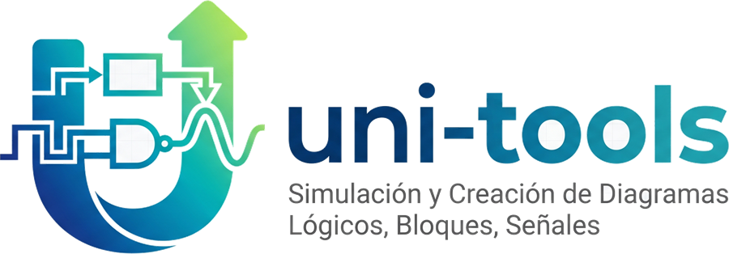

# uni-tools

Herramientas para la cursada: dibujar diagramas de control y circuitos lógicos, simularlos y
exportarlos. Todo corre en el navegador, sin instalar nada ni necesitar un servidor.

**Probalo online:** https://gez-schegtel.github.io/uni-tools/

## Las herramientas

| Herramienta | Para qué sirve |
|---|---|
| **Diagrama de bloques** (`diagrama-bloque.html`) | Bloques con ecuaciones (fracciones apiladas, exponentes, subíndices, letras griegas), sumadores y bifurcaciones. Un bloque admite una sola entrada: la segunda flecha avisa y no se crea. Las flechas se rutean solas y, una vez seleccionadas, se pueden correr a mano. Recuadros para agrupar, colores por elemento y área de impresión (A4, A3, 16:9…). |
| **Circuitos lógicos** (`simulador-logico.html`) | Compuertas, biestables (con uno *Custom* editable), semisumadores y sumadores. Simulación en vivo, reloj con 3 modos, tabla de verdad con la expresión mínima (Quine–McCluskey) y tabla de excitación. Cables que se rutean solos, compuertas giratorias, recuadros, colores y área de impresión. |
| **Diagrama de señales** (`diagrama-señales.html`) | Nodos y transmitancias, con análisis completo por la regla de Mason: ecuaciones, trayectorias, lazos, Δ, cofactores y función de transferencia (simbólica y numérica). Genera el diagrama de bloques equivalente, que se abre en la otra herramienta. |

Lo que tienen en común las tres:

- Atajos de teclado y una leyenda en la barra de estado (el botón **?** los explica todos).
- Deshacer y rehacer, copiar, cortar, pegar y duplicar, ajuste a la grilla (se puede apagar) y edición del tamaño y las opciones de cada elemento.
- Zoom y desplazamiento con mouse, trackpad o pantalla táctil (un dedo mueve, dos hacen zoom).
- Ejemplos para arrancar.
- Botón **Inicio** para volver a la portada, y **autoguardado**: lo que vas haciendo queda guardado en el navegador y al volver a abrir la herramienta seguís donde lo dejaste (no reemplaza a «Guardar»: no viaja a otra compu).
- Exportación a **SVG, PNG y JSON**; se puede volver a abrir un **JSON** o un **SVG** exportado desde acá (el SVG lleva los datos adentro).

## Cómo usarlo

- **Online:** entrá al link de arriba.
- **En tu compu:** descargá el repo y abrí `index.html` con doble clic. No hay nada que compilar. Si querés que se vean los logos, servilo por HTTP, por ejemplo con `python -m http.server` y entrando a `http://localhost:8000`.

## Cómo está hecho

```
index.html                  portada
diagrama-bloque.html        ┐
simulador-logico.html       ├ las tres herramientas, ARMADAS: no se editan a mano
diagrama-señales.html       ┘
src/
  construir.js              arma los tres HTML de arriba (Node pelado, sin npm)
  comun/                    lo compartido: historial, ids, copiar/pegar, teclado, zoom,
                            gestos táctiles, abrir/exportar, autoguardado, colores, área
                            de impresión, recuadros, ruteo ortogonal, CSS base, pedazos de HTML
  bloque/ simulador/ senales/
                            lo propio de cada una: pagina.html (plantilla), estilos.css,
                            herramienta.js (lo que el código común necesita saber de ella)
                            y sus módulos (modelo, dibujo, panel, interacción, exportar…)
tests/                      suite de Playwright (Chromium y Firefox) y unidades de los
                            cálculos puros; es lo único con npm
.github/workflows/          tests.yml (pruebas) y static.yml (publica en GitHub Pages)
```

Cada herramienta que se publica es **un solo archivo HTML autocontenido**: el CSS, el JavaScript y los íconos viven adentro. No hay frameworks, ni CDN, ni dependencias. Por eso funcionan sin internet y se pueden mandar por mail o llevar en un pendrive.

Esos HTML se **arman** a partir de las fuentes de [`src/`](src/): lo que comparten las tres (deshacer, copiar y pegar, teclado, zoom, gestos táctiles, abrir y exportar, autoguardado, colores, área de impresión…) vive una sola vez en `src/comun/`, y lo propio de cada una en `src/bloque/`, `src/simulador/` y `src/senales/`. Después de tocar una fuente:

```bash
node src/construir.js          # vuelve a armar las páginas de la raíz (Node pelado, sin npm)
```

Las páginas armadas se commitean junto con sus fuentes, así que el sitio se sigue publicando tal cual y el doble clic sigue andando. Las notas de arquitectura para quien quiera tocar el código están en [`CLAUDE.md`](CLAUDE.md) y en [`.claude/skills/uni-tools/SKILL.md`](.claude/skills/uni-tools/SKILL.md).

## Pruebas

Hay una suite automática con Playwright en `tests/`, que corre en Chromium y en Firefox. Además de los comportamientos, comprueba que los **resultados** sean correctos contra referencias independientes: Mason contra resolver el sistema lineal del grafo, la simplificación contra una búsqueda exhaustiva del mínimo, las tablas de verdad, los biestables y las ecuaciones de los bloques. Corre sola en GitHub Actions (`.github/workflows/tests.yml`) en cada push a `main` o `features` y en cada pull request. Para correrla en tu compu:

```bash
cd tests && npm install && npx playwright install chromium firefox && npm test
```

Las pruebas corren sobre las páginas armadas, así que primero hay que correr `node src/construir.js`. Si alguna página quedó desactualizada respecto de `src/`, lo avisan tanto las pruebas como el workflow de GitHub.

Los cálculos puros (la regla de Mason, la lógica de las compuertas y el analizador de ecuaciones de los bloques) tienen además pruebas unitarias que corren sin navegador ni dependencias: `node --test "tests/unidades/*.test.js"`.

`npm` se usa **sólo** para las pruebas; las herramientas siguen siendo HTML sueltos. Detalles en [`tests/README.md`](tests/README.md).

## Contribuir

Los cambios van a la rama `features` (el flujo de trabajo y las convenciones están en [`CLAUDE.md`](CLAUDE.md)); `main` es lo que se publica en GitHub Pages y se actualiza cuando ya se comprobó que todo anda. Los cambios se hacen en `src/` (nunca a mano en los HTML de la raíz): después correr `node src/construir.js` y las pruebas.

## Licencia

Software libre bajo la **GNU GPL v3 o posterior** (`GPL-3.0-or-later`). Podés usarlo, estudiarlo, modificarlo y redistribuirlo; si distribuís una versión modificada, tiene que seguir siendo libre bajo la misma licencia. Texto completo en [`LICENSE`](LICENSE). Las imágenes del logo (`uni-tools-*.png/jpg`) quedan afuera de esta licencia.
